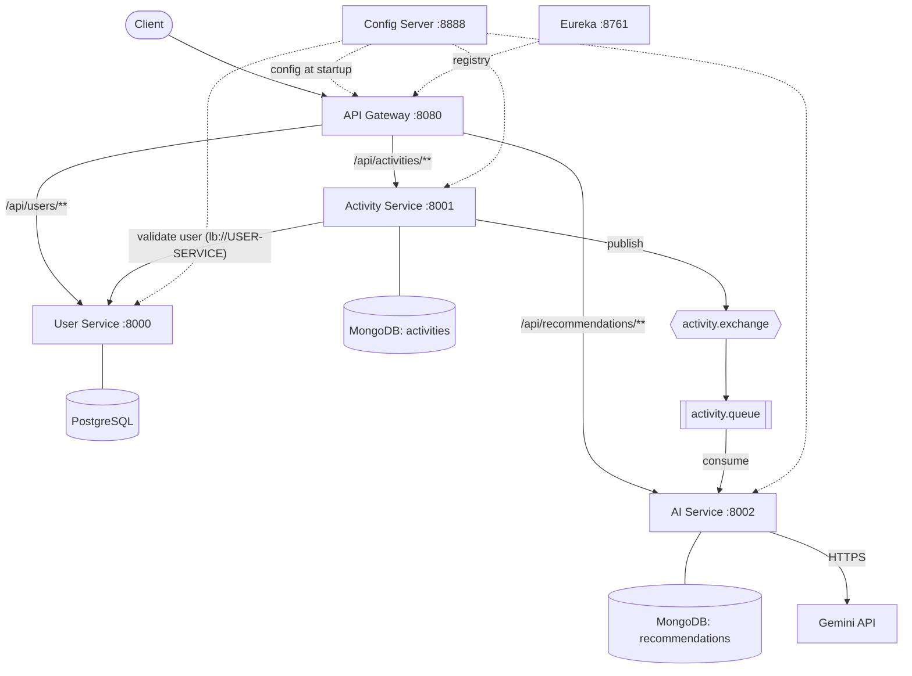
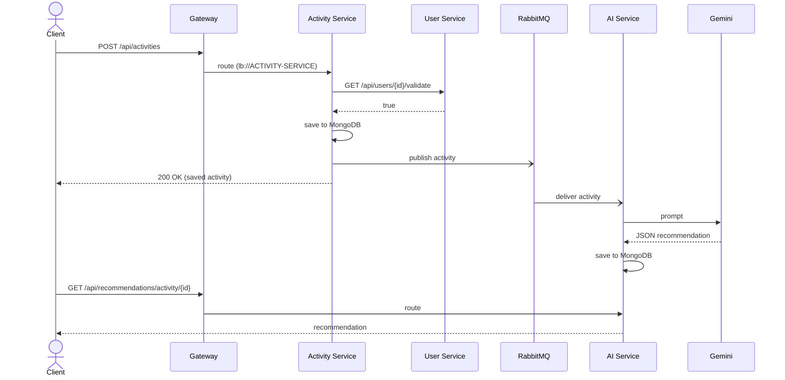

# Repwise
**Fitness Tracking Platform with AI Workout Recommendations**

> Track every rep. Train smarter.


Repwise lets a user log a workout and get a personalised coaching recommendation for it, written from that session's own numbers: duration, calories, start time and any extra metrics.

It is built as a set of independent Spring Boot microservices. Clients talk to a single API gateway. Services find each other through a Eureka registry, load their settings from a central config server, own their own data stores, and communicate over load-balanced HTTP and asynchronous RabbitMQ messages.

> **Warning: work in progress, not production-ready.** There is no authentication yet, so the `X-User-ID` header is trusted as sent and any caller can read any user's data. The Gemini integration sends workout data to a third-party API. Do not use real personal data.

## How it works

1. **Register** a user through the gateway. The password is hashed with BCrypt before it is stored.
2. **Track an activity.** The Activity Service validates the request, checks with the User Service that the user exists, saves the activity to MongoDB, and returns immediately.
3. **Publish.** The saved activity is published to RabbitMQ as JSON. If publishing fails the failure is logged and the activity is still saved.
4. **Recommend.** The AI Service consumes the message, builds a prompt from the activity, and asks Gemini for a structured JSON reply.
5. **Store and serve.** The reply is parsed into a `Recommendation` (analysis, improvements, suggestions, safety notes), saved to MongoDB, and served by user or by activity.

## Architecture



All services register with Eureka. The gateway, User, Activity and AI services fetch their configuration from the Config Server at startup.

### Request flow



Each service is a self-contained Maven project with its own wrapper, build and database. There is deliberately no shared parent POM or shared library, so any service can be built, tested, deployed and scaled on its own.

## Services

| Service | Directory | Port | Datastore | Status |
|---|---|---|---|---|
| Config Server | `config-server` | 8888 | none | Working |
| Eureka Server | `eureka` | 8761 | none | Working |
| API Gateway | `gateway` | 8080 | none | Working |
| User Service | `userservice` | 8000 | PostgreSQL | Working |
| Activity Service | `activityservice` | 8001 | MongoDB | Working |
| AI Service | `aiservice` | 8002 | MongoDB | In progress |
| RabbitMQ (broker) | external | 5672 (AMQP), 15672 (management UI) | none | Required |

Each service has a fixed port so they can all run side by side locally. Ports live in `server.port` in the service's file under `config-server/src/main/resources/configs/` (Eureka and the config server keep theirs in their own `application.properties`), and can be overridden with `SERVER_PORT` in the environment.

### Config Server
Central configuration for the Gateway, User, Activity and AI services. It serves property files from `config-server/src/main/resources/configs/` (Spring Cloud Config's `native` profile). A file's name must match the client's `spring.application.name`:

| File | Applies to |
|---|---|
| `application.properties` | every client: Eureka URL, RabbitMQ connection, and the queue, exchange and routing key names |
| `gateway.properties` | Gateway: port and routes |
| `user-service.properties` | User Service: port, PostgreSQL |
| `activity-service.properties` | Activity Service: port, MongoDB |
| `ai-service.properties` | AI Service: port, MongoDB, Gemini |

Each client keeps only `spring.application.name` and `spring.config.import=configserver:...` in its own `application.properties` and fetches the rest at startup. Because the RabbitMQ names live in one shared file, the Activity and AI services cannot drift apart.

Secrets are not stored in the config files. Values such as `${MONGODB_URI}` are served unresolved and each client fills them in from its own environment variables, so the config server never needs them. Changes to the files take effect after the config server is rebuilt and the clients are restarted.

### Eureka Server
Service registry that all other services register with. It does not register itself, does not fetch a registry, and is deliberately not a config client, so the registry does not depend on the config server.

### API Gateway
Single entry point for clients (reactive Spring Cloud Gateway Server WebFlux, running on Netty). It registers with Eureka and forwards requests by path to load-balanced `lb://` URIs resolved through the registry. Routes are defined in `gateway.properties`:

| Path | Forwarded to |
|---|---|
| `/api/users/**` | `USER-SERVICE` |
| `/api/activities/**` | `ACTIVITY-SERVICE` |
| `/api/recommendations/**` | `AI-SERVICE` |

Paths that match no route return 404. Headers such as `X-User-ID` pass through unchanged. If no instance of a target service is registered, the gateway returns 503. Right after a service starts there can be a short delay (about half a minute) before the gateway sees it. The services stay reachable directly on their own ports.

### User Service
Handles registration and profile lookup, with Bean Validation on incoming requests (valid email, password of at least 6 characters). Passwords are hashed with BCrypt before they are stored and are never returned in responses. Users are stored in PostgreSQL through Spring Data JPA, with generated UUID identifiers, creation and update timestamps, and a `USER` or `ADMIN` role. It also exposes a lightweight validation endpoint used by other services.

### Activity Service
Records and retrieves workouts. Before saving an activity it calls the User Service through a load-balanced `WebClient` (`http://USER-SERVICE`, resolved via Eureka) to confirm the user exists, and rejects the request if not. Activities are stored in MongoDB and support a free-form `metrics` map for type-specific data.

Requests are validated before anything else happens: `userId`, `type`, `duration` (greater than 0), `caloriesBurned` (0 or more) and `startTime` are required.

After saving, it publishes the activity as JSON to RabbitMQ (exchange `activity.exchange`, routing key `activity.tracking`). A failure to publish is logged but does not fail the request, so the activity is still saved.

Supported activity types: `RUNNING`, `SWIMMING`, `WALKING`, `CYCLING`, `WEIGHT_LIFTING`, `PUNCHING_BAG`, `ROPE_SKIPPING`, `AEROBICS`.

### AI Service
Generates and serves personalised recommendations for logged activities.

It listens on `activity.queue` for activities published by the Activity Service, builds a prompt from each one and calls the Gemini API through `WebClient`. The reply is parsed into a `Recommendation` and saved to MongoDB. A recommendation contains a structured analysis (overall, pace, heart rate, calories) plus lists of improvements, suggestions and safety notes. Endpoints return recommendations by user or by activity.

## Features

- **Event-driven.** Saving an activity never waits for the AI. The Activity Service publishes to RabbitMQ and returns, and the AI Service works through the queue at its own pace.
- **Service discovery and load balancing.** Every service registers with Eureka. Calls use `lb://` and `http://SERVICE-NAME` URIs instead of hard-coded hosts.
- **Centralised configuration.** One config server, one shared file for the RabbitMQ names, secrets read from the environment and never committed.
- **Reactive gateway.** Spring Cloud Gateway on WebFlux, so routing does not block threads.
- **Database per service.** PostgreSQL for users, MongoDB for activities and recommendations. No service reads another's database.
- **Session-specific AI output.** The prompt requires every point to be grounded in the logged numbers and the activity type. Gemini is asked for JSON only, and the reply is parsed into a typed `Recommendation`.
- **Hashed passwords.** BCrypt via `spring-security-crypto`. Passwords are never returned by the API.
- **Input validation.** Bean Validation on registration and on activity requests. Invalid input returns a 400 listing every failed field.
- **Consistent errors.** Each service has a `@RestControllerAdvice` that maps specific exceptions to HTTP statuses and a uniform JSON body. See [Error Handling](#error-handling).
- **Resilient publishing.** A RabbitMQ outage does not lose the workout. It is saved first, and the publish failure is logged.

## Error Handling

Each service with a REST API has a `@RestControllerAdvice` class (`exception/GlobalExceptionHandler`) that turns exceptions into a consistent JSON body. Services throw specific exceptions; only the handler chooses status codes. Anything unexpected is logged with its stack trace and returned as a generic 500, so internal details are not exposed.

```json
{
  "status": 404,
  "error": "Not Found",
  "message": "User not found: abc",
  "path": "/api/users/abc",
  "timestamp": "2026-10-31T09:12:00",
  "details": []
}
```

`details` lists per-field messages for validation errors and is empty otherwise.

| Status | When |
|---|---|
| `400` | Validation failed, malformed JSON or unknown enum value, or a missing `X-User-ID` header |
| `404` | User, activity or recommendation not found, or the user in an activity request does not exist |
| `409` | Registering an email that is already taken |
| `503` | The Activity Service cannot reach the User Service, or it responds with an error |
| `500` | Any unhandled error |

Errors raised inside the RabbitMQ listener of the AI Service are not HTTP errors and are not covered by this.

## API Reference

Every endpoint is available through the gateway at `localhost:8080` and directly on the service's own port. Errors use the [shape above](#error-handling).

### User Service (`:8000`)

| Method | Endpoint | Description |
|---|---|---|
| `POST` | `/api/users/register` | Register a new user |
| `GET` | `/api/users/{userId}` | Get a user profile |
| `GET` | `/api/users/{userId}/validate` | Returns `true` if the user exists |

```json
POST /api/users/register
{
  "email": "jane@example.com",
  "password": "secret123",
  "firstName": "Jane",
  "lastName": "Doe"
}
```

### Activity Service (`:8001`)

| Method | Endpoint | Description |
|---|---|---|
| `POST` | `/api/activities` | Track a new activity |
| `GET` | `/api/activities` | List activities for the user in the `X-User-ID` header |
| `GET` | `/api/activities/{activityId}` | Get a single activity |

```json
POST /api/activities
{
  "userId": "<user id>",
  "type": "RUNNING",
  "duration": 45,
  "caloriesBurned": 420,
  "startTime": "2026-10-29T06:30:00",
  "additionalMetrics": { "distanceKm": 7.2 }
}
```

### AI Service (`:8002`)

| Method | Endpoint | Description |
|---|---|---|
| `GET` | `/api/recommendations/user/{userId}` | List a user's recommendations |
| `GET` | `/api/recommendations/activity/{activityId}` | Get the recommendation for an activity |

## Tech Stack

- Java 21, Spring Boot 4.1.2, Spring Cloud 2025.1.4
- Spring Web MVC, Spring WebFlux (`WebClient`)
- Spring Cloud Gateway (WebFlux), Netflix Eureka, Config Server
- RabbitMQ through Spring AMQP, with JSON message conversion
- Google Gemini API for recommendation generation
- Spring Data JPA with PostgreSQL, Spring Data MongoDB
- Spring Security Crypto (BCrypt), Jakarta Bean Validation, Lombok
- Maven (wrapper included in every service)

## Quick start

### Prerequisites

- JDK 21
- Linux, macOS or WSL (the Windows `mvnw.cmd` wrapper scripts are not included)
- PostgreSQL running on `localhost:5432` with a database named `repwise_users_db`
- A MongoDB instance (local or Atlas)
- RabbitMQ on `localhost:5672`, for example with Docker:
  ```bash
  docker run -d --name rabbit -p 5672:5672 -p 15672:15672 rabbitmq:4-management
  ```
  The management UI is then at http://localhost:15672 (`guest` / `guest`).
- A Gemini API key (for the AI Service)

### Configuration

Secrets and environment-specific values are read from environment variables, never committed. Each service reads the variables it needs from its own environment, even though the property files that mention them live on the config server.

| Variable | Used by | Required | Purpose |
|---|---|---|---|
| `CONFIG_SERVER_URL` | Gateway, User, Activity, AI | no | Config server address, default `http://localhost:8888` |
| `DB_USERNAME` | User Service | yes | PostgreSQL username |
| `DB_PASSWORD` | User Service | yes | PostgreSQL password |
| `MONGODB_URI` | Activity, AI | yes | MongoDB connection string |
| `GEMINI_API_KEY` | AI Service | yes | Gemini API key |
| `GEMINI_API_URL` | AI Service | no | Gemini endpoint, defaults to the `gemini-2.5-flash` `generateContent` endpoint |
| `RABBITMQ_HOST` | Activity, AI | no | Broker host, default `localhost` |
| `RABBITMQ_PORT` | Activity, AI | no | Broker port, default `5672` |
| `RABBITMQ_USERNAME` | Activity, AI | no | Broker username, default `guest` |
| `RABBITMQ_PASSWORD` | Activity, AI | no | Broker password, default `guest` |

The queue, exchange and routing key names (`rabbitmq.queue.name`, `rabbitmq.exchange.name`, `rabbitmq.routing.key`) are defined once in the config server's shared `application.properties`.

```bash
export DB_USERNAME=postgres
export DB_PASSWORD=your_password
export MONGODB_URI="mongodb://localhost:27017/repwise"
export GEMINI_API_KEY=your_gemini_key
```

### Running

Start RabbitMQ and the config server first, then the registry, then the rest. The Gateway, User, Activity and AI services fail to start if the config server is not reachable. Each in its own terminal:

```bash
cd config-server   && ./mvnw spring-boot:run
cd eureka          && ./mvnw spring-boot:run
cd gateway         && ./mvnw spring-boot:run
cd userservice     && ./mvnw spring-boot:run
cd activityservice && ./mvnw spring-boot:run
cd aiservice       && ./mvnw spring-boot:run
```

Open the Eureka dashboard at http://localhost:8761 to confirm the services have registered. The gateway needs a short time to see newly registered services.

### Try it

All calls go through the gateway on port 8080:

```bash
# 1. Register a user and note the returned id
curl -X POST localhost:8080/api/users/register \
  -H "Content-Type: application/json" \
  -d '{"email":"jane@example.com","password":"secret123","firstName":"Jane","lastName":"Doe"}'

# 2. Track an activity for that user
curl -X POST localhost:8080/api/activities \
  -H "Content-Type: application/json" \
  -d '{"userId":"<id>","type":"RUNNING","duration":45,"caloriesBurned":420,"startTime":"2026-10-29T06:30:00"}'

# 3. List the user's activities
curl localhost:8080/api/activities -H "X-User-ID: <id>"

# 4. Fetch the generated recommendations (give the AI Service a few seconds)
curl localhost:8080/api/recommendations/user/<id>
```

After step 2 the AI Service log should show the saved recommendation. You can also watch `activity.queue` in the RabbitMQ management UI.

## Project structure

```
repwise/
├── config-server/     Centralised configuration
├── eureka/            Service registry
├── gateway/           API gateway (single entry point)
├── userservice/       Users and profiles (PostgreSQL)
├── activityservice/   Workout tracking (MongoDB)
├── aiservice/         Recommendations (MongoDB, Gemini)
└── README.md
```

Each business service follows the same layered layout:

```
<service>/src/main/java/com/repwise/<service>/
├── controller/    thin HTTP layer
├── service/       business logic
├── repository/    Spring Data interfaces
├── model/         entities and documents
├── dto/           request, response and error bodies
├── exception/     specific exceptions + GlobalExceptionHandler
└── config/        RabbitMQ, Mongo, WebClient, security beans
```

## Limitations and roadmap

**Known limitations**
- There is no authentication or authorisation. `X-User-ID` and the `userId` in a request body are client-supplied and trusted.
- A message whose processing fails (Gemini error, unparseable reply, database error) is requeued immediately and retried without limit. Retry limits and a dead-letter queue are not configured.
- A redelivered message can produce a second recommendation for the same activity.
- The User Service has no login endpoint yet. Users created before BCrypt was added have plaintext passwords and need to be re-registered.
- Test coverage is limited to the default context-load tests, which need the config server running.

**Roadmap**
- [x] Centralised configuration with a config server
- [x] API gateway as a single entry point
- [x] Event-driven flow from Activity Service to AI Service via RabbitMQ
- [x] Generate AI recommendations with Gemini and save them to MongoDB
- [x] Centralised error handling with proper HTTP status codes
- [x] Hash passwords with BCrypt
- [x] Request validation for activities
- [ ] Retry limits and a dead-letter queue for failed messages
- [ ] Avoid duplicate recommendations when a message is redelivered
- [ ] Authentication and authorisation
- [ ] Containerisation with Docker Compose
- [ ] Unit and integration test coverage

## Troubleshooting

- **A service fails to start with `ConfigClientFailFastException`:** the config server is not running. Start it first, or set `CONFIG_SERVER_URL`.
- **Gateway returns 503 for a service that is running:** wait about 30 seconds for the gateway to refresh its registry, and check the service appears on http://localhost:8761.
- **Activity request returns 503:** the Activity Service cannot reach the User Service. Check that it is registered in Eureka.
- **No recommendation appears:** check the AI Service log for Gemini errors and confirm `GEMINI_API_KEY` is set. A failing message is retried continuously, so look for repeated errors.
- **Activity saves but nothing reaches the queue:** RabbitMQ was down at publish time. The failure is logged by the Activity Service and the activity is not re-sent.

## License

MIT. See [LICENSE](LICENSE).

## Author

Karabo Charles Matsepane
