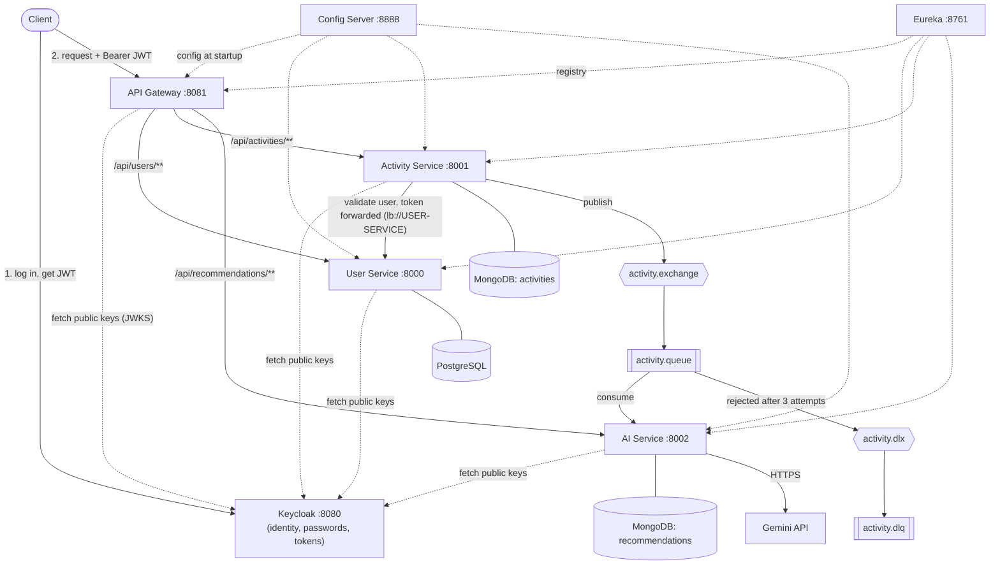
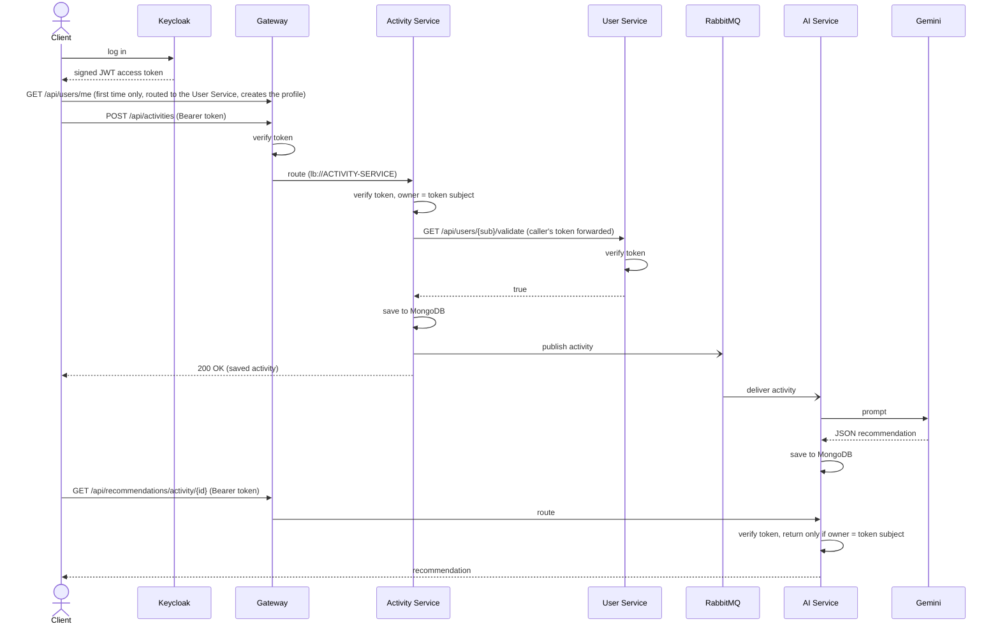

# Repwise
**Fitness Tracking Platform with AI Workout Recommendations**

> Track every rep. Train smarter.


Repwise lets a user log a workout and get a personalised coaching recommendation for it, written from that session's own numbers: duration, calories, start time and any extra metrics.

It is built as a set of independent Spring Boot microservices. Clients talk to a single API gateway. Services find each other through a Eureka registry, load their settings from a central config server, own their own data stores, and communicate over load-balanced HTTP and asynchronous RabbitMQ messages.

> **Warning: work in progress, not production-ready.** The gateway and the User, Activity and AI services require a Keycloak-issued JWT, and the Activity and AI services take the user from the token. Every endpoint needs a token, and users can only read their own data, except admins, who can read any user's profile. The Gemini integration sends workout data to a third-party API. Do not use real personal data.

## How it works

1. **Sign up and log in with Keycloak.** Keycloak stores the credentials and issues a signed access token. The platform never stores passwords.
2. **Create a profile.** The first call to `GET /api/users/me` creates the user's profile in the User Service from the token's claims. Later calls return it.
3. **Track an activity.** The Activity Service validates the request, takes the user from the token (not from the request), checks with the User Service (forwarding the caller's token) that the user has a profile, saves the activity to MongoDB, and returns immediately.
4. **Publish.** The saved activity is published to RabbitMQ as JSON. If publishing fails the failure is logged and the activity is still saved.
5. **Recommend.** The AI Service consumes the message, builds a prompt from the activity, and asks Gemini for a structured JSON reply. If processing fails, the message is tried up to 3 times in total, then moved to a dead-letter queue instead of being lost or retried forever (see [Failed messages](#failed-messages-and-the-dead-letter-queue)).
6. **Store and serve.** The reply is parsed into a `Recommendation` (analysis, improvements, suggestions, safety notes), saved to MongoDB, and served to its owner.

## Architecture



Dashed arrows are background connections, solid arrows carry requests. All services register with Eureka, and the gateway, User, Activity and AI services fetch their configuration from the Config Server at startup.

**Authentication.** Keycloak is the only place that knows passwords. It issues signed JWT access tokens. The gateway and the User, Activity and AI services each fetch Keycloak's public keys once and verify every token locally (signature, issuer, expiry), so no service calls Keycloak per request and each is protected even when called directly on its own port. The Activity and AI services take the user from the token's `sub` claim and never from the request.

### Request flow



Each service is a self-contained Maven project with its own wrapper, build and database. There is deliberately no shared parent POM or shared library, so any service can be built, tested, deployed and scaled on its own.

## Services

| Service | Directory | Port | Datastore | Status |
|---|---|---|---|---|
| Config Server | `config-server` | 8888 | none | Working |
| Eureka Server | `eureka` | 8761 | none | Working |
| API Gateway | `gateway` | 8081 | none | Working |
| User Service | `userservice` | 8000 | PostgreSQL | Working |
| Activity Service | `activityservice` | 8001 | MongoDB | Working |
| AI Service | `aiservice` | 8002 | MongoDB | In progress |
| RabbitMQ (broker) | external | 5672 (AMQP), 15672 (management UI) | none | Required |

Each service has a fixed port so they can all run side by side locally. Ports live in `server.port` in the service's file under `config-server/src/main/resources/configs/` (Eureka and the config server keep theirs in their own `application.properties`), and can be overridden with `SERVER_PORT` in the environment.

### Config Server
Central configuration for the Gateway, User, Activity and AI services. It serves property files from `config-server/src/main/resources/configs/` (Spring Cloud Config's `native` profile). A file's name must match the client's `spring.application.name`:

| File | Applies to |
|---|---|
| `application.properties` | every client: Eureka URL, RabbitMQ connection, and the queue, exchange, routing key and dead-letter names |
| `gateway.properties` | Gateway: port, routes, Keycloak issuer URI |
| `user-service.properties` | User Service: port, PostgreSQL, Keycloak issuer URI |
| `activity-service.properties` | Activity Service: port, MongoDB, Keycloak issuer URI |
| `ai-service.properties` | AI Service: port, MongoDB, Gemini, Keycloak issuer URI |

Each client keeps only `spring.application.name` and `spring.config.import=configserver:...` in its own `application.properties` and fetches the rest at startup. Because the RabbitMQ names live in one shared file, the Activity and AI services cannot drift apart.

Secrets are not stored in the config files. Values such as `${MONGODB_URI}` are served unresolved and each client fills them in from its own environment variables, so the config server never needs them. Changes to the files take effect after the config server is rebuilt and the clients are restarted.

### Eureka Server
Service registry that all other services register with. It does not register itself, does not fetch a registry, and is deliberately not a config client, so the registry does not depend on the config server.

### API Gateway
Single entry point for clients (reactive Spring Cloud Gateway Server WebFlux, running on Netty). It registers with Eureka and forwards requests by path to load-balanced `lb://` URIs resolved through the registry. Routes are defined in `gateway.properties`:

| Path | Forwarded to |
|---|---|
| `/api/users/**` | `USER-SERVICE` |
| `/api/activities/**` | `ACTIVITY-SERVICE` |
| `/api/recommendations/**` | `AI-SERVICE` |

#### Authentication

The gateway is an OAuth2 resource server. Users log in to Keycloak, which issues a signed JWT access token, and the client sends it as `Authorization: Bearer <token>`. The gateway (`SecurityConfig`) checks the signature, issuer and expiry on every request and returns 401 if the token is missing or invalid. It never sees passwords. It downloads Keycloak's public keys once, using the `issuer-uri` set in `gateway.properties`, and verifies tokens locally.

Every route requires a valid token. Public paths are added with `pathMatchers(...).permitAll()` in `SecurityConfig`. The token is forwarded to the services, and the User, Activity and AI services verify it again themselves, so they are protected even if called directly on their own ports.

Paths that match no route return 404. Headers, including `Authorization`, pass through unchanged. If no instance of a target service is registered, the gateway returns 503. Right after a service starts there can be a short delay (about half a minute) before the gateway sees it. The services stay reachable directly on their own ports.

### User Service
Stores user profiles. Identity (sign-up, credentials, login, tokens) belongs to Keycloak, so this service has no registration endpoint and stores no passwords. It is an OAuth2 resource server: every endpoint needs a valid access token, including the validation endpoint, which the Activity Service calls with the caller's token forwarded.

It reads Keycloak realm roles from the token's `realm_access.roles` claim and exposes them as `ROLE_*` authorities (the role `admin` becomes `ROLE_ADMIN`), ready for `hasRole` rules; `GET /api/users/{id}` lets users with `ROLE_ADMIN` read any profile.

A profile's id is the user's Keycloak id (the token's `sub` claim). `GET /api/users/me` returns the caller's profile and creates it from the token's `email`, `given_name` and `family_name` claims on first use, so the Keycloak user needs an email; without one, a first-time user gets a 400 and no profile is created. Profiles are stored in PostgreSQL through Spring Data JPA with creation and update timestamps and a `USER` or `ADMIN` role. `GET /api/users/{id}/validate` is a lightweight existence check used by the Activity Service, which forwards the caller's token.

### Activity Service
Records and retrieves workouts. It is an OAuth2 resource server: every endpoint needs a valid access token, and the token's `sub` claim is the owner of each activity. The request body carries no user id, users only see their own activities, and another user's activity id returns 404. Before saving an activity it calls the User Service through a load-balanced `WebClient` (`http://USER-SERVICE`, resolved via Eureka) to confirm the user has a profile, and rejects the request if not. If the User Service rejects the forwarded token (for example it expired between the two calls), the request fails with 401 so the client knows to get a new token. Activities are stored in MongoDB and support a free-form `metrics` map for type-specific data.

Requests are validated before anything else happens: `type`, `duration` (greater than 0), `caloriesBurned` (0 or more) and `startTime` are required.

After saving, it publishes the activity as JSON to RabbitMQ (exchange `activity.exchange`, routing key `activity.tracking`). A failure to publish is logged but does not fail the request, so the activity is still saved.

Supported activity types: `RUNNING`, `SWIMMING`, `WALKING`, `CYCLING`, `WEIGHT_LIFTING`, `PUNCHING_BAG`, `ROPE_SKIPPING`, `AEROBICS`.

### AI Service
Generates and serves personalised recommendations for logged activities. It is an OAuth2 resource server: every HTTP endpoint needs a valid access token, a user only sees their own recommendations, and another user's recommendation returns 404. The RabbitMQ listener is not an HTTP entry point and is unaffected.

It listens on `activity.queue` for activities published by the Activity Service, builds a prompt from each one and calls the Gemini API through `WebClient`. Gemini must answer completely within 30 seconds (`GEMINI_API_TIMEOUT`), or the call fails and is retried like any other error, so a hanging Gemini cannot block the listener forever. The reply is parsed into a `Recommendation` and saved to MongoDB. An activity has at most one recommendation: RabbitMQ can deliver the same message more than once, so an activity that already has one is skipped without calling Gemini, and a unique index on `activityId` refuses a second one if two copies are processed at the same moment. Either way the duplicate message is acknowledged, not retried or dead-lettered. A recommendation contains a structured analysis (overall, pace, heart rate, calories) plus lists of improvements, suggestions and safety notes. Endpoints return the caller's recommendations, or the recommendation for one of the caller's activities.

### Failed messages and the dead-letter queue
Any failure while processing an activity (a Gemini error, no complete answer from Gemini within 30 seconds, a reply that is not the expected JSON, a database error) is retried by the listener: **3 attempts in total**, about a second apart. If the last attempt fails, the message is rejected without being requeued, and RabbitMQ moves it to the **dead-letter queue** `activity.dlq` through the dead-letter exchange `activity.dlx`. A message whose body cannot even be read as an activity goes there straight away. Either way the message is kept, with its original content and an `x-death` header recording where it came from, instead of being lost or retried forever.

| | |
|---|---|
| **Look at failed messages** | RabbitMQ management UI (http://localhost:15672) → Queues → `activity.dlq` → Get messages (keep "Nack message requeue true" so they stay). Or `docker exec rabbit rabbitmqctl list_queues name messages`. |
| **Change the number of attempts** | `spring.rabbitmq.listener.simple.retry.max-retries` in `aiservice/src/main/resources/application.properties`. It counts *retries*, so attempts = retries + 1 (`max-retries=2` means 3 attempts). |
| **Names** | `rabbitmq.dlx.name`, `rabbitmq.dlq.name` and `rabbitmq.dlq.routing.key` in the config server's shared `configs/application.properties`. |
| **Replaying** | Not automated yet. Fix the cause, then move the messages back to `activity.exchange` by hand. |

The activity queue's dead-letter settings are fixed when the queue is first created. Both services declare the queue and must declare it identically, and a broker that already has an `activity.queue` without these settings refuses the new declaration (`PRECONDITION_FAILED`): delete the old queue once (management UI, or `docker exec rabbit rabbitmqctl delete_queue activity.queue`) and restart the services.

## Features

- **Event-driven.** Saving an activity never waits for the AI. The Activity Service publishes to RabbitMQ and returns, and the AI Service works through the queue at its own pace.
- **Service discovery and load balancing.** Every service registers with Eureka. Calls use `lb://` and `http://SERVICE-NAME` URIs instead of hard-coded hosts.
- **Centralised configuration.** One config server, one shared file for the RabbitMQ names, secrets read from the environment and never committed.
- **Reactive gateway.** Spring Cloud Gateway on WebFlux, so routing does not block threads.
- **Database per service.** PostgreSQL for users, MongoDB for activities and recommendations. No service reads another's database.
- **Session-specific AI output.** The prompt requires every point to be grounded in the logged numbers and the activity type. Gemini is asked for JSON only, and the reply is parsed into a typed `Recommendation`. If the model wraps its JSON in a Markdown code fence (for example ```` ```json ````) or adds a sentence around it, the fenced block is unwrapped; valid JSON is never altered.
- **Delegated identity.** Keycloak handles sign-up, login and tokens. The gateway and the User, Activity and AI services verify the JWT's signature, issuer and expiry locally, and the platform stores no passwords.
- **Token-derived ownership.** The Activity and AI services take the user from the token, so a client cannot log or read activities and recommendations as someone else.
- **Input validation.** Bean Validation on activity requests. Invalid input returns a 400 listing every failed field.
- **Consistent errors.** Each service has a `@RestControllerAdvice` that maps specific exceptions to HTTP statuses and a uniform JSON body. See [Error Handling](#error-handling).
- **Resilient publishing.** A RabbitMQ outage does not lose the workout. It is saved first, and the publish failure is logged.
- **No lost or looping messages.** A message that cannot be processed is retried 3 times, then parked in a dead-letter queue with its content intact.
- **One recommendation per activity.** A redelivered message never causes a second Gemini call or a second recommendation, enforced by a unique index in MongoDB.

## Error Handling

Each service with a REST API has a `@RestControllerAdvice` class (`exception/GlobalExceptionHandler`) that turns exceptions into a consistent JSON body. Services throw specific exceptions; only the handler chooses status codes. Anything unexpected is logged with its stack trace and returned as a generic 500, so internal details are not exposed.

```json
{
  "status": 404,
  "error": "Not Found",
  "message": "User not found: abc",
  "path": "/api/users/abc",
  "timestamp": "2026-10-31T09:12:00",
  "details": []
}
```

`details` lists per-field messages for validation errors and is empty otherwise.

| Status | When |
|---|---|
| `400` | Validation failed, malformed JSON or unknown enum value, or a first-time user's token has no email address (`GET /api/users/me`) |
| `401` | Missing, expired or invalid access token (sent by the security filter with an empty body, not in the shape above), or, when tracking an activity, the User Service rejected the forwarded token (sent in the shape above) |
| `404` | User, activity or recommendation not found, an activity or recommendation that belongs to another user, or the caller has no profile yet when tracking an activity |
| `503` | The Activity Service cannot reach the User Service, or it responds with any error other than 401 |
| `500` | Any unhandled error |

Errors raised inside the RabbitMQ listener of the AI Service are not HTTP errors and are not covered by this.

## API Reference

Every endpoint is available through the gateway at `localhost:8081` and directly on the service's own port. Errors use the [shape above](#error-handling).

### User Service (`:8000`)

| Method | Endpoint | Description |
|---|---|---|
| `GET` | `/api/users/me` | Get the caller's profile, creating it on first use |
| `GET` | `/api/users/{userId}` | Get your own profile by id; admins can get any profile; other callers get 404 for any other id |
| `GET` | `/api/users/{userId}/validate` | Returns `true` if the id is yours and has a profile, otherwise `false` |

All need `Authorization: Bearer <token>`. Users sign up and log in through Keycloak, and there is no request body to send.

### Activity Service (`:8001`)

| Method | Endpoint | Description |
|---|---|---|
| `POST` | `/api/activities` | Track a new activity for the caller |
| `GET` | `/api/activities` | List the caller's activities |
| `GET` | `/api/activities/{activityId}` | Get one of the caller's activities |

All need `Authorization: Bearer <token>`. The owner is the token's subject, and the body takes no user id.

```json
POST /api/activities
{
  "type": "RUNNING",
  "duration": 45,
  "caloriesBurned": 420,
  "startTime": "2026-10-29T06:30:00",
  "additionalMetrics": { "distanceKm": 7.2 }
}
```

### AI Service (`:8002`)

| Method | Endpoint | Description |
|---|---|---|
| `GET` | `/api/recommendations` | List the caller's recommendations |
| `GET` | `/api/recommendations/activity/{activityId}` | Get the recommendation for one of the caller's activities |

Both need `Authorization: Bearer <token>`. The user is the token's subject, and no user id is accepted in the path.

## Tech Stack

- Java 21, Spring Boot 4.1.2, Spring Cloud 2025.1.4
- Spring Web MVC, Spring WebFlux (`WebClient`)
- Spring Cloud Gateway (WebFlux), Netflix Eureka, Config Server
- RabbitMQ through Spring AMQP, with JSON message conversion
- Google Gemini API for recommendation generation
- Spring Data JPA with PostgreSQL, Spring Data MongoDB
- Keycloak (OAuth2 / OpenID Connect) with Spring Security's OAuth2 resource server on the gateway
- Jakarta Bean Validation, Lombok
- Maven (wrapper included in every service)

## Quick start

### Prerequisites

- JDK 21
- Linux, macOS or WSL (the Windows `mvnw.cmd` wrapper scripts are not included)
- PostgreSQL running on `localhost:5432` with a database named `repwise_users_db`
- A MongoDB instance (local or Atlas). Locally, start it with `sudo systemctl start mongod` and use `MONGODB_URI=mongodb://localhost:27017/<database>`; the Activity and AI services should use different database names
- RabbitMQ on `localhost:5672`, for example with Docker:
  ```bash
  docker run -d --name rabbit -p 5672:5672 -p 15672:15672 rabbitmq:4-management
  ```
  The management UI is then at http://localhost:15672 (`guest` / `guest`).
- A Gemini API key (for the AI Service)
- Keycloak running locally with a realm, a client that has *Direct access grants* enabled (for testing with curl), and a user with an email, first name and last name (the profile is built from these). To use roles, create a realm role such as `admin` and assign it to a user; tokens requested afterwards carry it. To let people sign up themselves, turn on *User registration* in the realm's Login settings. Keycloak uses its default port 8080, which is why the gateway runs on 8081.

### Configuration

Secrets and environment-specific values are read from environment variables, never committed. Each service reads the variables it needs from its own environment, even though the property files that mention them live on the config server.

| Variable | Used by | Required | Purpose |
|---|---|---|---|
| `CONFIG_SERVER_URL` | Gateway, User, Activity, AI | no | Config server address, default `http://localhost:8888` |
| `DB_USERNAME` | User Service | yes | PostgreSQL username |
| `DB_PASSWORD` | User Service | yes | PostgreSQL password |
| `MONGODB_URI` | Activity, AI | yes | MongoDB connection string |
| `GEMINI_API_KEY` | AI Service | yes | Gemini API key |
| `GEMINI_API_URL` | AI Service | no | Gemini endpoint, defaults to the `gemini-2.5-flash` `generateContent` endpoint |
| `GEMINI_API_TIMEOUT` | AI Service | no | How long to wait for Gemini's complete answer before the call fails, default `30s` (accepts values such as `500ms`, `45s`, `2m`) |
| `RABBITMQ_HOST` | Activity, AI | no | Broker host, default `localhost` |
| `RABBITMQ_PORT` | Activity, AI | no | Broker port, default `5672` |
| `RABBITMQ_USERNAME` | Activity, AI | no | Broker username, default `guest` |
| `RABBITMQ_PASSWORD` | Activity, AI | no | Broker password, default `guest` |

The queue, exchange and routing key names (`rabbitmq.queue.name`, `rabbitmq.exchange.name`, `rabbitmq.routing.key`) and the dead-letter names (`rabbitmq.dlx.name`, `rabbitmq.dlq.name`, `rabbitmq.dlq.routing.key`) are defined once in the config server's shared `configs/application.properties`. The listener's retry settings are part of the AI Service itself, in its own `application.properties`.

```bash
export DB_USERNAME=postgres
export DB_PASSWORD=your_password
export MONGODB_URI="mongodb://localhost:27017/repwise"
export GEMINI_API_KEY=your_gemini_key
```

### Running

Start Keycloak, MongoDB, PostgreSQL and RabbitMQ first, then the config server, then the registry, then the rest. The services need Eureka up to find each other (the Activity Service calls the User Service by name). The Gateway, User, Activity and AI services fail to start if the config server is not reachable. Each in its own terminal:

```bash
cd config-server   && ./mvnw spring-boot:run
cd eureka          && ./mvnw spring-boot:run
cd gateway         && ./mvnw spring-boot:run
cd userservice     && ./mvnw spring-boot:run
cd activityservice && ./mvnw spring-boot:run
cd aiservice       && ./mvnw spring-boot:run
```

Open the Eureka dashboard at http://localhost:8761 to confirm the services have registered. The gateway needs a short time to see newly registered services.

### Try it

All calls go through the gateway on port 8081 and need a Keycloak access token (replace the placeholders; if your client is confidential, add `-d client_secret=<secret>`):

```bash
# 0. Get an access token and export it
TOKEN=$(curl -s -X POST http://localhost:<keycloak-port>/realms/<realm>/protocol/openid-connect/token \
  -d grant_type=password -d client_id=<client> \
  -d username=<user> -d password=<password> | jq -r .access_token)

# 1. Create your profile (first call) and note the returned id
curl localhost:8081/api/users/me -H "Authorization: Bearer $TOKEN"

# 2. Track an activity (the owner is taken from the token)
curl -X POST localhost:8081/api/activities \
  -H "Authorization: Bearer $TOKEN" \
  -H "Content-Type: application/json" \
  -d '{"type":"RUNNING","duration":45,"caloriesBurned":420,"startTime":"2026-10-29T06:30:00"}'

# 3. List your activities
curl localhost:8081/api/activities -H "Authorization: Bearer $TOKEN"

# 4. Fetch the generated recommendations (give the AI Service a few seconds)
curl localhost:8081/api/recommendations -H "Authorization: Bearer $TOKEN"
```

Without the `Authorization` header, or with an expired token, the gateway returns 401. Tokens are short-lived, so request a new one when that happens.

After step 2 the AI Service log should show the saved recommendation. You can also watch `activity.queue` in the RabbitMQ management UI.

## Project structure

```
repwise/
├── config-server/     Centralised configuration
├── eureka/            Service registry
├── gateway/           API gateway (single entry point)
├── userservice/       Users and profiles (PostgreSQL)
├── activityservice/   Workout tracking (MongoDB)
├── aiservice/         Recommendations (MongoDB, Gemini)
└── README.md
```

Each business service follows the same layered layout:

```
<service>/src/main/java/com/repwise/<service>/
├── controller/    thin HTTP layer
├── service/       business logic
├── repository/    Spring Data interfaces
├── model/         entities and documents
├── dto/           request, response and error bodies
├── exception/     specific exceptions + GlobalExceptionHandler
└── config/        RabbitMQ, Mongo, WebClient, security beans
```

## Limitations and roadmap

**Known limitations**
- Only `GET /api/users/{id}` uses roles (admins can read any profile). The Activity and AI services do not read roles, so there is no admin access to other users' activities or recommendations, and `/validate` is own-id only even for admins.
- The Activity Service forwards the caller's own access token to the User Service. Tokens are not restricted to a particular audience, so any service that receives one could replay it elsewhere. Add an audience check or use token exchange before production.
- The Activity Service rejects activities until the user has called `GET /api/users/me` once, because the profile does not exist before that.
- The Keycloak issuer URI is hard-coded to `localhost:8080` in the config files, and there are no role-based rules yet.
- The Keycloak client uses direct access grants (the password grant) for convenience in local testing. Use the authorization code flow with PKCE before deploying.
- Dead-lettered messages wait in `activity.dlq` until someone deals with them: there is no automatic replay, alert or expiry, and nothing consumes that queue.
- The retry pauses block the listener thread, so one failing message delays the ones behind it for a few seconds, or up to about a minute and a half if Gemini hangs on every attempt (3 attempts of up to 30 seconds each). The pause is a fixed interval, not a growing back-off.
- Changing the activity queue's dead-letter settings on a broker that already has the queue means deleting the queue first.
- The `users` table is managed by `ddl-auto=update`, which never drops old columns. After the move to Keycloak the old `password` column and `NOT NULL` constraint must be dropped by hand on an existing database.
- Test coverage is partial. The User, Activity and AI services have unit tests for their business logic, and their exception handlers are unit-tested where they hold logic (the generic 500 that hides internal details, the validation `details` list and the 401 for a rejected forwarded token), but the controllers, the security configuration and the routing of exceptions to the handlers through Spring have no tests yet, and the Gateway, Config Server and Eureka have only the default context-load tests, which need the config server running. The only integration test is the AI Service's dead-letter test (see [Tests](#tests)).

**Roadmap**
- [x] Centralised configuration with a config server
- [x] API gateway as a single entry point
- [x] Event-driven flow from Activity Service to AI Service via RabbitMQ
- [x] Generate AI recommendations with Gemini and save them to MongoDB
- [x] Centralised error handling with proper HTTP status codes
- [x] Move identity and passwords to Keycloak (profile-only User Service)
- [x] Request validation for activities
- [x] Retry limits and a dead-letter queue for failed messages
- [ ] Replay or alert on dead-lettered messages
- [x] Avoid duplicate recommendations when a message is redelivered
- [x] JWT validation at the gateway with Keycloak
- [x] Activity Service takes the user from the token and enforces ownership
- [x] AI Service verifies tokens and serves recommendations by the token's subject
- [x] Forward the user's token to the User Service and close `/validate`
- [x] Users can only read their own profile
- [x] User Service reads Keycloak realm roles from the token as `ROLE_*` authorities
- [x] Admins can read any user's profile
- [ ] Use roles in the Activity and AI services, and add admin-only endpoints (for example listing users)
- [ ] Authorization code flow with PKCE instead of the password grant
- [ ] Containerisation with Docker Compose
- [ ] Unit and integration test coverage

## Troubleshooting

- **A service fails to start with `ConfigClientFailFastException`:** the config server is not running. Start it first, or set `CONFIG_SERVER_URL`.
- **Gateway returns 503 for a service that is running:** wait about 30 seconds for the gateway to refresh its registry, and check the service appears on http://localhost:8761.
- **Gateway or service returns 401:** the token is missing, expired (they last about 5 minutes), or was issued by a different issuer than `spring.security.oauth2.resourceserver.jwt.issuer-uri`. Compare the token's `iss` claim with that property exactly, and check the property name is spelled `issuer-uri`, the port is Keycloak's (8080) and the value has no quotes. A broken `Authorization` header, such as `Bearer ` followed by an empty shell variable, is rejected before the request is processed.
- **A service fails with "required a bean of type JwtDecoder":** the `issuer-uri` property is not reaching it. Check the spelling and restart the config server, which serves the files from its own resources.
- **Tracking an activity returns 404 "User not found":** call `GET /api/users/me` once first so your profile exists.
- **`/api/users/me` returns 400 "Your account has no email address":** the Keycloak user has no email, which the profile requires. Add one to the user in the admin console and request a new token.
- **Gateway fails with "port already in use":** Keycloak uses 8080 and the gateway uses 8081. Check that nothing else is on those ports.
- **Activity request returns 503:** the Activity Service cannot reach the User Service. Check that Eureka is running and that both services are registered in it (wait about a minute after starting them), or restart the Activity Service.
- **A service cannot connect to the config server or its database:** check the port you are calling. The config server is on 8888 and answers almost any path with its own JSON; the services are on 8000, 8001 and 8002.
- **No recommendation appears:** check the AI Service log for Gemini errors (including timeouts) and confirm `GEMINI_API_KEY` is set. A failing message is tried 3 times and then parked in `activity.dlq`, so look for three errors in a row and check that queue.
- **A service fails with `PRECONDITION_FAILED ... inequivalent arg 'x-dead-letter-exchange'`:** `activity.queue` already exists on the broker without dead-letter settings. Delete it once and restart (see [Failed messages](#failed-messages-and-the-dead-letter-queue)).
- **A service fails with `Could not resolve placeholder 'rabbitmq.dlx.name'`:** the three dead-letter names are missing from the config server's `configs/application.properties`, or the config server was not restarted after adding them.
- **Activity saves but nothing reaches the queue:** RabbitMQ was down at publish time. The failure is logged by the Activity Service and the activity is not re-sent.
- **The AI Service fails at startup with `Cannot create index` for `activityId` (`E11000 duplicate key`):** the `recommendations` collection already holds more than one recommendation for some activity, saved before duplicates were prevented, so MongoDB cannot build the unique index. Keep the oldest recommendation for each activity and delete the rest, then restart. In `mongosh`, connected to the AI Service's database:
  ```js
  db.recommendations.aggregate([
    { $sort: { createdAt: 1 } },
    { $group: { _id: "$activityId", keep: { $first: "$_id" }, count: { $sum: 1 } } },
    { $match: { count: { $gt: 1 } } }
  ]).forEach(g => db.recommendations.deleteMany({ activityId: g._id, _id: { $ne: g.keep } }))
  ```

## Tests

Unit tests need nothing running. Each service's `contextLoads` test starts the whole application and needs the config server, databases and so on, so run the others by name instead of a bare `./mvnw test`:

```bash
cd userservice     && ./mvnw -Dtest='KeycloakRoleConverterTest,UserServiceTest*,GlobalExceptionHandlerTest*' test
cd activityservice && ./mvnw -Dtest='ActivityServiceTest*,UserValidationServiceTest*,GlobalExceptionHandlerTest*,RabbitMqTopologyTest' test
cd aiservice       && ./mvnw -Dtest='RecommendationServiceTest*,ActivityAiServiceTest*,GeminiServiceTest*,GlobalExceptionHandlerTest*,ActivityMessageListenerTest*,RecommendationIndexTest,RabbitMqTopologyTest' test
```

`ActivityMessageListenerDeadLetterTest` (AI Service) is an integration test: it starts a real RabbitMQ in a throwaway Docker container and checks retries and dead-lettering end to end. It needs Docker, takes about a minute, and is skipped if Docker is not available:

```bash
cd aiservice && ./mvnw -Dtest=ActivityMessageListenerDeadLetterTest test
```

The `*Test*` classes with nested groups need the trailing `*` (as above), or Maven reports zero tests. No test calls Gemini: `GeminiServiceTest` points the service at a fake Gemini on a local port.

## License

MIT. See [LICENSE](LICENSE).

## Author

Karabo Charles Matsepane
